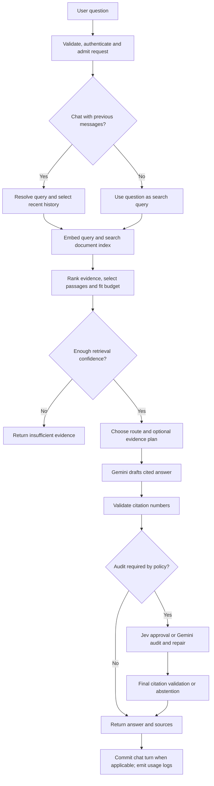

# How answer generation works today

Code audit baseline · 15 October 2026 · commit `6d2cf3a971f9299b217dd29a4341aa8393e807ee`

This document explains the implemented system before proposing changes. It distinguishes source-code behavior, effective local configuration, deployment templates, and historical evaluation results. Production environment settings, traffic, billing, database contents, and deployed migrations were not inspected. Model names and price figures below describe values in this repository; they are not a fresh verification of provider availability or pricing.

## 1. The system at a glance

This is a Python/FastAPI document-grounded question-answering backend for forest-department legal and policy material. It searches uploaded documents, sends selected passages to Gemini, and returns an answer with numbered citations. Jev/TypeSafe supplies optional probabilistic decisions around that process. Gemini writes the answers and any evidence plans or rewritten search queries.

There is no general autonomous agent loop, live web research, external legal database search, or model tool execution in the answer path. Retrieval searches the uploaded corpus. Answers cannot establish that the corpus contains every applicable or latest instrument.

The flow is sequential within a query. Batching combines some embedding requests; it does not make the whole answer pipeline parallel.

## 2. What is enabled here

[settings.py:13](/Users/anshumansharma/Documents/Playground/settings.py:13) loads the root `.env`; environment variables already supplied by the host take precedence. A safe allowlist of non-secret settings was inspected. This is a local snapshot, not evidence of production configuration. The companion JSON records the inspected values and source locations.

| Control | Code default | Effective local setting | Deployment evidence |
|---|---|---|---|
| Direct / utility / ordinary verifier | `gemini-3.5-flash-lite` | Same | Same in Render template |
| Complex answer / strong verifier | `gemini-3.8-flash` | Same | Same in Render template |
| Embedding | `gemini-embedding-2`, 768 dimensions | Same | Same in Render template |
| Eight Jev features | All `off` | All `active` | All `shadow` in Render and environment examples |
| Selective planning/history/evidence/reasoning/verification | Enabled with cost master | Enabled | Enabled in Render template |
| Lite extraction | `false` | `true` | Environment examples say `false` |
| Strong audits for high-risk answers | `false` | `true` | Environment examples say `false` |
| Legal hierarchy retrieval | `false` | Unset → `false` | Environment examples say `false` |
| Legal embedding batching | `false` | `true` | Only matters when legal retrieval runs |
| PDF table extraction | `true` | `false` | `false` in Render template |
| OCR fallback | `false` | `true` | Configurable Document AI service |
| Document storage | Local files | Cloudflare R2 | Configurable |

The master `RAG_COST_OPTIMIZATIONS` flag does not disable every cost-related feature. Jev modes, risk-based verification, and legal batching have independent switches. Source code is the authority where older prose differs.

## 3. Entry points and request protection

| Entry point | Behavior | Main code |
|---|---|---|
| `POST /ask` | One question; no conversation history or chat persistence | [routers/qa.py:11](/Users/anshumansharma/Documents/Playground/routers/qa.py:11) |
| `POST /chat/sessions/{session_id}/ask` | Query resolution, history selection, answer, atomic turn persistence | [routers/chat.py:65](/Users/anshumansharma/Documents/Playground/routers/chat.py:65), [chat_service.py:95](/Users/anshumansharma/Documents/Playground/chat_service.py:95) |
| `POST /admin/rag-lab/revisions/{revision_id}/query` | Test an experimental revision; persist a trial and latency | [routers/rag_lab.py:122](/Users/anshumansharma/Documents/Playground/routers/rag_lab.py:122), [rag_lab_service.py:244](/Users/anshumansharma/Documents/Playground/rag_lab_service.py:244) |
| `POST /admin/legal/preview` | Always use legal hierarchy retrieval; optionally generate an answer | [routers/legal.py:59](/Users/anshumansharma/Documents/Playground/routers/legal.py:59) |

Questions/messages are trimmed and limited to 8,000 characters. `top_k` is optional and limited to 1–20. It changes both anchor and final-context counts, while the token budget remains independently configured; it does not guarantee that exactly that many excerpts survive.

Before generation, middleware limits request size and applies IP admission limits. Authentication checks user access and applies user rate/concurrency limits when enabled. Redis limits default on in production. Default generation limits are 120 requests/minute/IP, 20/minute/user, eight concurrent globally and two/user, subject to overrides. These bound traffic rather than per-answer spending. See [schemas.py:7](/Users/anshumansharma/Documents/Playground/schemas.py:7), [security_middleware.py:14](/Users/anshumansharma/Documents/Playground/security_middleware.py:14), [auth.py:211](/Users/anshumansharma/Documents/Playground/auth.py:211), [request_limits.py:56](/Users/anshumansharma/Documents/Playground/request_limits.py:56), [security_settings.py:35](/Users/anshumansharma/Documents/Playground/security_settings.py:35).

Answers run synchronously in request handlers; they are returned as complete JSON responses. Celery handles ingestion and experiment jobs, not ordinary answer generation. The startup script runs the API and a single-concurrency Celery worker in the same container. See `start-render.sh`, `tasks.py`, and `task_queue.py`.

## 4. Chat: resolving the user's actual question

[chat_service.py:95](/Users/anshumansharma/Documents/Playground/chat_service.py:95) claims a turn before any model work. A completed request with the same session, request ID, and payload returns its saved response. Reusing the ID with different input conflicts. A session lease prevents overlapping turns. If the client omits `request_id`, the server creates a new one, so separate submissions are not deduplicated automatically.

The repository reads prior messages and their source payloads from the database. Although the fetch is not explicitly limited or paginated in this path, model prompts normally use only the last ten messages. There is no durable rolling summary or semantic memory of earlier turns. Legacy citations may cause an additional document-ID lookup.

Query-resolution branches, in order:

1. Jev's rewrite gate, when enabled and history exists, evaluates whether the message is fully standalone. In active mode, probability ≥0.99 skips the Gemini rewrite. History may still be supplied to drafting.
2. If Jev history selection is active, Gemini rewrites the query and Jev separately owns history selection.
3. Otherwise, sufficiently long histories can use a combined Gemini rewrite-and-selection call. Eligibility requires more than one assistant reply in the last ten messages and over 1,500 estimated history tokens.
4. Other turns use the ordinary Gemini rewrite. With no previous messages, that helper returns the original question without an API call.
5. Jev history selection then runs if eligible and enabled. It protects all user messages in the recent window and the latest assistant reply; only clearly irrelevant older assistant replies can be removed, at keep probability ≤0.01. Uncertainty retains context.

The selected messages remain verbatim. Gemini selection has fallbacks for invalid indices and an unusable search query; a fallback rewrite can add another call. Active Jev history mode bypasses the combined Gemini history selector. See [conversation_context.py:26](/Users/anshumansharma/Documents/Playground/conversation_context.py:26), [prompts.py:533](/Users/anshumansharma/Documents/Playground/prompts.py:533), [jev_policy.py:100](/Users/anshumansharma/Documents/Playground/jev_policy.py:100), [jev_shadow.py:90](/Users/anshumansharma/Documents/Playground/jev_shadow.py:90).

**Important distinction:** retrieval uses the rewritten standalone query, while planning, routing, verification, and drafting receive the original latest question. Drafting and Jev route/planning decisions also receive selected history; the separate Gemini evidence planner and verifier do not receive that history or the rewritten query explicitly. They see question plus excerpts, and the verifier also sees the draft. This difference matters when assessing follow-up interpretation.

## 5. Ordinary retrieval: finding and selecting evidence

[retrieval.py:157](/Users/anshumansharma/Documents/Playground/retrieval.py:157) is the shared entry. With local settings it uses ordinary retrieval, because legal hierarchy is off.

### Breadth and prompt budgets

Question shape is classified by English regular expressions, without a classifier-model call. Comparisons take precedence over overviews and procedures; unmatched wording becomes direct. A separate temporal shape expands retrieval for historical/current/amendment-related wording. This is distinct from the answer-model route.

| Retrieval shape | Candidates per search | Anchor passages | Maximum final passages | Excerpt-token budget |
|---|---:|---:|---:|---:|
| Direct | 50 | 4 | 5 | 3,000 |
| Procedure | 80 | 6 | 8 | 5,000 |
| Comparison | 100 | 8 | 10 | 7,000 |
| Overview | 120 | 8 | 12 | 8,000 |
| Temporal | 120 | 8 | 12 | 8,000 |

These are configured maxima, not observed usage. Budgets estimate passage text, excluding source headers, legal annotations, history, instructions, and the evidence plan. The first passage is preserved even if it alone exceeds the budget. Local estimates use `cl100k_base`, not a Gemini billing tokenizer. See [retrieval.py:58](/Users/anshumansharma/Documents/Playground/retrieval.py:58), [retrieval.py:121](/Users/anshumansharma/Documents/Playground/retrieval.py:121), [retrieval.py:514](/Users/anshumansharma/Documents/Playground/retrieval.py:514), [chunking.py:9](/Users/anshumansharma/Documents/Playground/chunking.py:9).

### Retrieval operations

1. **Expand some queries.** Overviews use the original query plus up to three fixed facets: governing provisions; procedure/authority; and conditions, fees, exceptions, or penalties. Other shapes normally use one query. Expansion is deterministic, not generative.
2. **Embed.** Query text is prefixed for the configured embedding model, embedded into 768 dimensions, and unit-normalized. Multiple overview queries use one batch embedding request.
3. **Hybrid database search.** Each query invokes `match_document_chunks`, combining vector similarity, English full-text search, reciprocal rank terms, and small metadata boosts. The latest implementation in migration 011 filters for indexed documents. Broad-query database searches are executed sequentially.
4. **Check identifiers for updates.** If legal identifiers occur and the query is not historical, an extra amendment/update query adds one embedding and one database search. This does not guarantee that all amendments are found.
5. **Merge and rank.** Merge by chunk ID, retain strongest database similarity, track cross-query hits, then apply deterministic boosts for lexical/heading overlap, legal identifiers, year, chunk type, bounded recency, and repeated query hits. Apply a noise penalty.
6. **Optional Jev reranking.** Evaluate at most the first 12 candidates for direct relevance and material qualifications. Active mode can promote confident passages while preserving the first original anchor and every candidate's database score. Shadow mode makes the call but keeps baseline ordering.
7. **Choose anchors.** With selective evidence enabled, remove only verbatim contained evidence within the same known document, source, section, and date context. Similar-looking provisions with different provenance remain distinct. The default per-source cap is zero, meaning unlimited; when configured, deferred passages can still backfill the selection.
8. **Add neighbors.** Fetch adjacent chunks at radius one for a bounded subset of anchors. Direct matches keep priority; exception/amendment-bearing neighbors get priority in remaining slots. The RPC can use the anchor's index revision for consistent neighbors.
9. **Pack whole passages.** Keep ranked passages within passage-count and estimated-text budgets; later oversized passages may be skipped.

See [retrieval.py:273](/Users/anshumansharma/Documents/Playground/retrieval.py:273), [retrieval.py:316](/Users/anshumansharma/Documents/Playground/retrieval.py:316), [retrieval.py:401](/Users/anshumansharma/Documents/Playground/retrieval.py:401), [retrieval.py:462](/Users/anshumansharma/Documents/Playground/retrieval.py:462), [repositories.py:115](/Users/anshumansharma/Documents/Playground/repositories.py:115), `migrations/011_atomic_document_indexing.sql:190`.

### What confidence means

Confidence is a heuristic from the strongest matched score plus up to 0.12 for nearby supporting scores. It is not a calibrated probability that the answer is correct. The local gate is `0.01`, and minimum context score is `0.0`; thus, nonempty weak matches can reach generation. Below the gate, the system returns a fixed insufficient-evidence answer without planning or drafting. It has already paid the retrieval costs. See [retrieval.py:529](/Users/anshumansharma/Documents/Playground/retrieval.py:529).

## 6. Alternative legal retrieval

[legal_retrieval.py:65](/Users/anshumansharma/Documents/Playground/legal_retrieval.py:65) runs when the global legal flag is enabled, or directly through admin legal preview. It is implemented but is not the local ordinary-query path.

It searches six stages: handbook, Act, rules, amendments, implementation material, and judicial material. Each stage searches both reviewed classified material and ordinary legacy/unclassified chunks, up to 30 candidates from each. Handbook references inform later query identifiers. Reviewed relationships are traversed in both directions, bounded to three hops and 30 additional documents; related-document searches retrieve up to three passages each.

Without batching, the six stages require six embedding requests. With the locally enabled batching flag, handbook is embedded first and the remaining five queries share one batch request: two requests for six items, with 12 stage database searches either way. Relationship retrieval adds one embedding request and up to 30 searches. Batching reduces request overhead, not necessarily billed tokens.

Selection protects one relevant reviewed candidate per available category before filling remaining slots; the default final budget is ten passages and 8,000 excerpt tokens. The prompt receives legal profiles, reviewed date overrides, missing category/link checks, and an explicit `collection_currentness=unverified` limitation. These annotations guide reasoning; they are not excerpt evidence or proof of legal authority. Missing checks do not automatically force abstention: the model is instructed to qualify or abstain when they prevent a conclusion.

The preview's as-of/jurisdiction fields are conveyed as review metadata, rather than comprehensive database filters. Reviewed registry annotations are scoped by namespace; uploaded source text remains the underlying shared corpus. Preview without answer generation still incurs retrieval work. See `legal_registry.py`, [routers/legal.py:60](/Users/anshumansharma/Documents/Playground/routers/legal.py:60), [legal_retrieval.py:169](/Users/anshumansharma/Documents/Playground/legal_retrieval.py:169).

## 7. Planning and choosing the answer model

After the confidence gate, source formatting assigns stable excerpt numbers, provenance, pages, sections, evidence roles, and known dates. Exact repeated text and repeated legal annotations are aliased to save prompt space while preserving labels. See [prompts.py:98](/Users/anshumansharma/Documents/Playground/prompts.py:98).

Jev routing and planning, if either is enabled, share one decision request reading the question, source block, and history. Gemini still performs any requested evidence planning. The planner returns structured themes, central conclusion, supporting source numbers, qualifications, conflicts, and unknowns. Planning failure via `AppError` continues without a plan.

Baseline planning applies to procedures, comparisons, and overviews, subject to switches. A procedure can skip planning when evidence is small, from one known source/document, has at most four passages and 2,500 formatted-source tokens, and has no high-risk route or request for exhaustive coverage. Eligible Lite extraction also skips baseline planning. Active Jev can add a plan; it can remove one only within guarded simple-extraction conditions. See [prompts.py:155](/Users/anshumansharma/Documents/Playground/prompts.py:155), [prompts.py:337](/Users/anshumansharma/Documents/Playground/prompts.py:337), [jev_shadow.py:16](/Users/anshumansharma/Documents/Playground/jev_shadow.py:16).

Answer routes are selected in this order:

| Route | Trigger and guard | Model / thinking |
|---|---|---|
| Eligible extraction | Lite shortcut enabled; explicit extraction/list/summary/application wording; one document, ≤4 passages, ≤2,000 passage tokens; no history and none of the excluded legal conditions | Lite / minimal |
| High-risk legal reasoning | With risk flag, judicial/current-applicability wording or judicial profiles; also conflict, temporal/amendment/repeal language, plan conflicts, or amendment references | Flash / high |
| Small dated amendment fact | Narrow lookup, one small already-effective dated amendment, one reference, no historical/current/conflict conditions | Flash / medium; checked before generic amendment escalation |
| Broader synthesis | Procedure/comparison/overview, or non-narrow questions with ≥3 known documents or ≥8 passages | Flash / medium |
| Ordinary direct | Remaining questions | Lite / minimal |

The extraction eligibility guard excludes judicial/unreviewed legal profiles, missing legal-review coverage, amendments, exemptions/exceptions, cross-instrument qualifications, and temporal/applicability/conflict questions. It is deliberately narrow. Eligibility is not proof that the draft is accurate. See [model_routing.py:8](/Users/anshumansharma/Documents/Playground/model_routing.py:8), [prompts.py:273](/Users/anshumansharma/Documents/Playground/prompts.py:273).

Active Jev can upgrade ordinary routes. It can downgrade ordinary complex work only for guarded extraction without history; it cannot downgrade a final baseline high-risk route. Route changes trigger an audit. A high-risk change forces a strong audit. See [jev_shadow.py:72](/Users/anshumansharma/Documents/Playground/jev_shadow.py:72).

## 8. Drafting and checking the answer

The draft prompt includes instructions, excerpts, today's server date, up to ten selected messages, the optional plan, and the original latest question. It asks for source-only claims; precise applicability and amendment treatment; explicit uncertainty; inline citations for material claims; short direct answers; structured broader answers; and a brief evidence-grounded follow-up sentence on supported answers. Drafting instructions are in the user prompt; separate planner/verifier calls also supply a system instruction.

Output budgets describe configured ceilings, not desired answer lengths:

| Operation | Default output ceiling | Temperature | Thinking |
|---|---:|---:|---|
| Rewrite | 200 | 0 | minimal |
| Rewrite plus history selection | 600 | 0 | minimal |
| Evidence plan | 1,200 | 0 | low |
| Direct answer | 1,800 | 0.1 | minimal |
| Complex answer | 4,000 | 0.1 | medium |
| High-risk answer | 8,192 | 0.1 | high |
| Ordinary verification | 3,000 | 0 | low |
| Strong verification | 4,000 | 0 | medium |

The configured model output budget also needs room for thinking. Visible response length can be much smaller. See [services/gemini.py:61](/Users/anshumansharma/Documents/Playground/services/gemini.py:61) and [prompts.py:358](/Users/anshumansharma/Documents/Playground/prompts.py:358).

### Citation validation is not factual verification

Before and after any model audit, deterministic validation requires at least one valid numeric citation, normalizes grouped numbers, and rejects malformed or out-of-range numeric citations. It does not prove that every claim has a citation or that the cited passage supports the claim. Failure returns a fixed unsupported-answer response; it does not request a citation repair. See [prompts.py:486](/Users/anshumansharma/Documents/Playground/prompts.py:486).

### When a separate audit runs

1. High-risk answers receive a direct strong Gemini audit when the risk flag is enabled, or when a route change requires it. Local risk mode is enabled.
2. Eligible Lite extractions and changed routes receive an audit. Procedures, comparisons, and overviews receive one when ordinary answer verification is enabled.
3. Other direct answers can return after citation validation without a separate model audit. A high model route alone does not force auditing when the relevant risk policy is off.

Jev active verification owns only eligible small extraction cases without history/high-risk concerns. It checks claim support, preserved conditions, and scope; all three probabilities must be ≥0.99. Approval retains the draft. Rejection returns unsupported immediately. A technical failure uses the configured policy: locally `closed`, so it also returns unsupported. `baseline` allows Gemini fallback on technical unavailability, not on a completed negative decision. Ineligible cases go directly to Gemini. Shadow verification keeps the Gemini decision after making an eligible Jev observation.

Gemini audits the full selected evidence and can return a corrected answer. Compact clean approvals omit repeated answer text. If ordinary verification rejects or yields unacceptable semantic output, a stronger verifier can audit the original draft. A transport/quota `AppError` returns unsupported without another verifier call. There is no retrieval retry, new evidence search, or iterative answer-agent loop after rejection. See [prompts.py:191](/Users/anshumansharma/Documents/Playground/prompts.py:191), [prompts.py:254](/Users/anshumansharma/Documents/Playground/prompts.py:254), [prompts.py:450](/Users/anshumansharma/Documents/Playground/prompts.py:450), [jev_policy.py:25](/Users/anshumansharma/Documents/Playground/jev_policy.py:25).

## 9. Model calls, retries, and likely cost drivers

Useful counts below assume successful requests, confident evidence, ordinary retrieval, no structured-output parse recovery, and the locally active Jev modes. They count logical generation calls separately from embedding and Jev requests.

| Scenario | Gemini generation calls | Other typical work |
|---|---|---|
| Ordinary direct fact; no plan/upgrade/audit | 1 draft | 1 embedding; 1 hybrid search; up to 1 Jev rerank and 1 Jev route/planning call; neighbor reads |
| Guarded simple extraction; Jev approves | 1 draft | Same retrieval/decision work plus 1 Jev verifier |
| Procedure without a plan; Gemini owns audit | 2: draft + audit | Retrieval and Jev decisions |
| Planned overview/comparison; ordinary audit passes | 3: plan + draft + audit | Overview normally embeds 4 query items in one batch and makes 4 hybrid searches |
| High-risk answer without a plan | 2: draft + strong audit | Temporal retrieval can be broader; identifier updates add work |
| Chat follow-up needing references resolved | Add 1 rewrite | Add Jev rewrite gate; long history may add Jev history selection |
| Completed chat request replay with same ID/payload | 0 | Database claim/replay, plus admission/authentication |
| Insufficient retrieval | 0 after retrieval | Embedding/search/rerank already occurred |

Jev can add a plan or upgrade a route, changing these counts. Ordinary-verifier escalation adds one strong generation call. Each source block may be transmitted to Jev reranking, route/planning, evidence planning, drafting, and verification. Reducing one pass saves repeated input as well as its output/thinking; an extra decision also has cost and latency.

The Gemini client has separate layers of recovery:

- HTTP/network retry: locally up to three generation retries or seven embedding retries, with exponential delays. Generation retry deadline is 150 seconds; embedding deadline is 300 seconds. Deadlines gate retry scheduling, rather than guaranteeing a strict end-to-end query time limit.
- Truncation recovery: one complete regeneration at twice the output ceiling, bounded by 16,384, when `MAX_TOKENS` occurs. It reuses the full prompt; it does not continue partial output. Repeated truncation raises an error.
- Structured output: up to two generation attempts to obtain a JSON object. Semantic requirements are then checked by the caller; this is not a general JSON-schema validation engine.
- Jev: no transport retries; bounded input payload and timeout. Oversized input or invalid responses return unavailable.

These layers can multiply actual provider attempts; one logical stage is not always one billable request. See [services/gemini.py:186](/Users/anshumansharma/Documents/Playground/services/gemini.py:186), [services/gemini.py:420](/Users/anshumansharma/Documents/Playground/services/gemini.py:420), [services/gemini.py:511](/Users/anshumansharma/Documents/Playground/services/gemini.py:511), [services/jev.py:17](/Users/anshumansharma/Documents/Playground/services/jev.py:17).

There is no application answer cache, semantic response cache, persistent query-embedding cache, persistent Jev decision cache, or explicit Gemini cached-content creation in this path. Provider-reported cached tokens are accounted for if present. Completed chat-turn replay, ingestion fingerprinting, extracted-file reuse in RAG Lab, and connection-client caches serve narrower purposes.

## 10. Where the searchable evidence comes from

Document preparation affects both retrieval quality and answer cost. Ordinary ingestion is separate from answering:

1. Read TXT, PDF, DOCX, PPTX, or legacy PPT from configured storage.
2. Extract text and available structure. PDF table extraction is implemented but locally off. OCR is locally on and targets PDF pages with fewer than 40 useful alphanumeric characters, up to 200 OCR pages; it does not automatically detect every garbled text/table case.
3. Infer title, document type, authority, identifiers, and conservative explicit dates from a bounded sample, usually the first five pages/20,000 characters. Ambiguous dates stay unknown; amendment references are bounded. These are inferred metadata, not a full document review.
4. Fingerprint content and relevant indexing settings. An identical published fingerprint skips indexing work after document reading/extraction.
5. Optional Jev document policy samples first/middle/last extracted pages, at most 4,000 characters each. Active classification can choose automatic chunk profile and store a non-authoritative instrument suggestion. Active extraction review can block ordinary indexing at corruption probability ≥0.99. It is not an all-page completeness check.
6. Split along headings, clauses, FAQ pairs, procedures, and tables. Default section chunks are 600 estimated tokens with 100 overlap; FAQ 650/80; procedure 600/120. Carry headings and provenance.
7. Add retrieval-oriented title/type/authority/identifier text, embed, and store staged chunks. Ordinary ingestion embeds each chunk individually; `INGEST_BATCH_SIZE=24` batches database inserts. RAG Lab uses batch embeddings, default two items/request, and caches extracted documents.
8. Atomically publish complete revisions under database leases/fencing. Failed refreshes preserve the last successful index. Indexing has a 3,000-chunk document limit. Jobs have separate recovery/retry handling.

RAG Lab builds configurable experimental revisions, persists answer trials, and can publish a ready revision into the ordinary corpus. Its active extraction policy locally warns rather than blocks experimental builds. It shares the answer pipeline, but fixed lab `top_k`/candidate settings differ from adaptive defaults; a lab comparison is not automatically a like-for-like production comparison.

See [documents.py:46](/Users/anshumansharma/Documents/Playground/documents.py:46), [documents.py:494](/Users/anshumansharma/Documents/Playground/documents.py:494), [chunking.py:530](/Users/anshumansharma/Documents/Playground/chunking.py:530), [ingest_service.py:33](/Users/anshumansharma/Documents/Playground/ingest_service.py:33), [ingest_service.py:103](/Users/anshumansharma/Documents/Playground/ingest_service.py:103), [rag_lab_service.py:103](/Users/anshumansharma/Documents/Playground/rag_lab_service.py:103), [rag_lab_service.py:219](/Users/anshumansharma/Documents/Playground/rag_lab_service.py:219), migrations 011 and 013.

## 11. What is returned, stored, and measured

Responses include answer, outcome, all selected source excerpts, actually cited sources, heuristic retrieval confidence, and an abstained flag. Chat also includes the resolved search query, request/session IDs, and committed user/assistant messages. Sources include full selected text, document IDs, page ranges, chunk positions, scores, and roles.

Outcomes are `answered`, `insufficient_evidence`, `unsupported_answer`, or `not_generated`. Some model failures become unsupported answers through verification/planning handling; others return API errors. An upstream call succeeding is not the same as an answer being supported.

Chat commit writes both messages and the replayable response atomically, including source snapshots and basic outcome/confidence metadata. Usage records are emitted to structured logs rather than attached as full stage accounting to the saved turn. RAG Lab saves question, answer, evidence, retrieval settings, outcome, and overall latency. Query accounting wraps all four query entry paths.

| Measured today | Important interpretation |
|---|---|
| Generation operation/model, prompt/output/thinking/cached tokens, per-call duration and estimated cost | Includes returned truncation attempts and structured retries |
| Route, question shape, evidence counts, planning and prompt-size estimates | Helpful for explaining why a model was selected |
| Request-local stage totals, embeddings/items, Jev decisions, escalation counts | Unknown usage/prices remain unknown rather than zero |
| Request HTTP status and elapsed time | No complete database/retrieval stage timing breakdown |
| Jev decisions, disagreement, probability and applied decisions | Probabilities are not validated production accuracy guarantees |
| Advisory generation-cost threshold | `COST_QUERY_MAX_INR=1.5` flags excess; it does not enforce a spending cap and does not compare total API cost |

Generation price estimates use hardcoded model-specific standard-tier rates and an illustrative ₹90/USD conversion. Unknown models/tiers or missing usage produce unknown estimates. Embedding cost requires provider token metadata plus a matching configured model/rate; that price configuration is absent locally, so a nonzero embedding workload cannot be fully priced by the current local settings. Jev has a configured/default input-token estimate. OCR, hosting, database, storage, Redis, tax, and other infrastructure costs are outside per-query API totals.

See [generation_cost.py:22](/Users/anshumansharma/Documents/Playground/generation_cost.py:22), [token_usage.py:64](/Users/anshumansharma/Documents/Playground/token_usage.py:64), [token_usage.py:79](/Users/anshumansharma/Documents/Playground/token_usage.py:79), `structured_logging.py`, `migrations/013_consistency.sql:179`.

## 12. Evidence already available about correctness and cost

The current local regression run completed with **387 passed, 16 skipped, one dependency deprecation warning**. The skipped tests are opt-in isolated PostgreSQL and Redis integration tests. Most pipeline tests use mocked model/storage services; this run validates programmed branches and boundaries, not real-model legal accuracy or deployed database behavior.

Test families cover routing, history and token efficiency, evidence selection, legal hierarchy, Jev rollout/negative decisions, truncation, cost accounting, API contracts, atomicity, security, document downloads, and experimental revisions. The autouse fixture resets all Jev modes to off and three optional flags to false; individual feature tests explicitly enable them. Therefore, a green default test run is not a representative live run of the all-active local configuration.

Existing saved evaluations are small synthetic checks. Their numerical costs reflect historical runs and repository price assumptions; no new paid model evaluation was run for this audit.

- `docs/cost_evaluation.json`: five fixed-evidence cases in baseline/optimized modes. Four substantive cases pass their listed fact-presence checks; the exact-earlier-quote case fails its check in both modes. This does not test real retrieval or establish overall quality parity.
- `docs/lite_routing_evaluation_initial.json`: prior policy allowed an exception-related procedure whose draft/audit behavior prompted tighter eligibility. The later four-output report passes listed form/ownership/approval/citation presence checks, on closely related unconditional synthetic questions.
- `docs/jev_evaluation.json`: all seven API calls succeeded, but only **five of seven behavioral checks passed**. Supported-draft approval and standalone-query skipping failed their expected checks. Transport success must not be reported as full behavioral success; these are historical smoke findings, not current production error rates.
- `docs/jev_shadow_evaluation.json`: records four successful transport/observation calls. It does not establish accuracy or savings.
- Other saved evidence-policy and token-efficiency smoke reports exercise selected repairs, exemptions, unsupported claims, escalation, and token handling. Their scope is narrow and partly fixed-evidence.

The first regression attempt could not load the tokenizer because its public data file was absent from cache and network access was restricted. After downloading that public dependency to a temporary cache, the suite passed without code changes. No production data, paid generation, migrations, or deployment was needed.

## 13. Baseline findings to carry into the next stage

These are properties and evidence gaps, not a ranked change proposal:

| Finding | Why it matters for a later optimization decision |
|---|---|
| Local all-active settings differ from default-off code and shadow deployment templates | We must establish the actual production policy before attributing cost/quality to it |
| Jev can save some Gemini work and also add calls, plans, or stronger audits | Net benefit depends on workload distribution and decision quality |
| Some direct answers are not independently audited | A universal verification setting cannot be assumed from its name |
| Citation syntax is checked deterministically; semantic support is conditional | A citation-bearing response is not itself evidence of correct grounding |
| Retrieval confidence threshold is permissive and uncalibrated | Poor relevance can reach drafting; returned confidence should not be read as answer accuracy |
| Retrieval rewrite and downstream question handling use different representations | Follow-up references can be clear to retrieval/drafting but less explicit to planning or auditing |
| History is a ten-message window; all stored messages/sources are fetched first | Long-term scope can drop out, while database payload can grow |
| Retrieval breadth, legal stages, neighbors, repeated evidence transmission, thinking, and retries all contribute | Draft-model price alone cannot explain end-to-end cost |
| Passage budgets are estimates and exclude substantial prompt overhead | Configured 3,000–8,000 tokens are not total billed input limits |
| No general answer/embedding/decision cache exists | Repeated independent queries repeat most work; chat replay helps only matching request IDs |
| Local PDF table extraction is off; OCR is based on low text quantity | Table/reading-order quality and missed corruption need source-to-extraction inspection |
| Ordinary chunk embeddings are individual requests; Lab batches them | Ingestion and query costs need separate accounting |
| Local embedding prices are unconfigured; infrastructure is excluded | Existing generation-cost figures do not establish total operating cost |
| Saved evaluations include false rejection and reference-handling failures | Synthetic success and transport success are insufficient evidence for broad rollout |
| Unused legacy settings remain locally | `GEMINI_ANSWER_TEMPERATURE`, `GEMINI_MAX_OUTPUT_TOKENS`, and `RAG_OVERVIEW_TOP_K` have no consuming answer-path code; current profiles/budgets use other keys |

To move from understanding to measured optimization, the missing baseline is the deployed configuration plus a representative set of queries joined to route, retrieval, answer/outcome, stage usage/latency, and expert quality labels. Relevant labels include correct source retrieval, citation support, missing conditions, temporal applicability, false abstentions, and task completion. This audit makes no production-wide savings or accuracy claim.

## 14. Codebase coverage and navigation

The review traced the answer-producing entry points through shared retrieval, model clients, prompts, history, evidence preparation, persistence, SQL search implementations, flags, telemetry, evaluations, tests, and deployment setup. Supporting authentication/upload/worker files were inspected for their relationship to that flow; this is not a separate line-by-line security audit. The frontend is not present in this repository, so browser rendering and client retry/request-ID behavior remain outside the observed scope.

| Area | Files |
|---|---|
| Application and endpoints | `app.py`, `routers/qa.py`, `routers/chat.py`, `routers/legal.py`, `routers/rag_lab.py`, `routers/documents.py`, `routers/system.py`, `schemas.py`, `responses.py`, `rag.py` |
| Answer orchestration | `chat_service.py`, `conversation_context.py`, `prompts.py`, `model_routing.py` |
| Retrieval and applicability | `retrieval.py`, `legal_retrieval.py`, `legal_registry.py`, `temporal.py` |
| Providers and decisions | `services/gemini.py`, `services/jev.py`, `jev_policy.py`, `jev_shadow.py`, `jev_settings.py` |
| Evidence preparation | `documents.py`, `chunking.py`, `ingest_service.py`, `services/document_ai.py`, `services/document_storage.py`, `services/storage.py`, `upload_utils.py` |
| Experiments and storage | `rag_lab_service.py`, `rag_lab_repository.py`, `services/rag_lab_storage.py`, `repositories.py` |
| Jobs and consistency | `tasks.py`, `task_queue.py`, `job_recovery.py`, `consistency.py`, SQL migrations and schemas |
| Access and admission | `auth.py`, `auth_repository.py`, `routers/auth_routes.py`, `routers/admin.py`, `security_middleware.py`, `security_settings.py`, `request_limits.py` |
| Accounting and failures | `generation_cost.py`, `token_usage.py`, `structured_logging.py`, `redaction.py`, `errors.py`, `rag_errors.py`, `settings.py` |
| Verification material | `tests/`, `scripts/evaluate_*.py`, `scripts/legal_backfill.py`, existing `docs/` reports and policy notes |
| Runtime configuration | `requirements.txt`, `pyproject.toml`, `Dockerfile`, `docker-compose.yml`, `start-render.sh`, `render.yaml`, safe local setting values and environment examples |

The companion `code-map.json` supplies navigable function/class line locations and a safe configuration snapshot. Existing uncommitted operating-cost artifacts were left intact. This audit adds documentation only.
